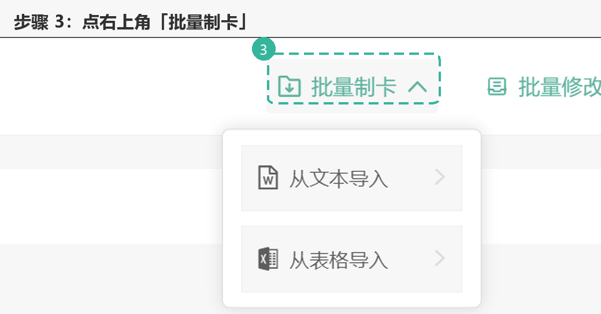
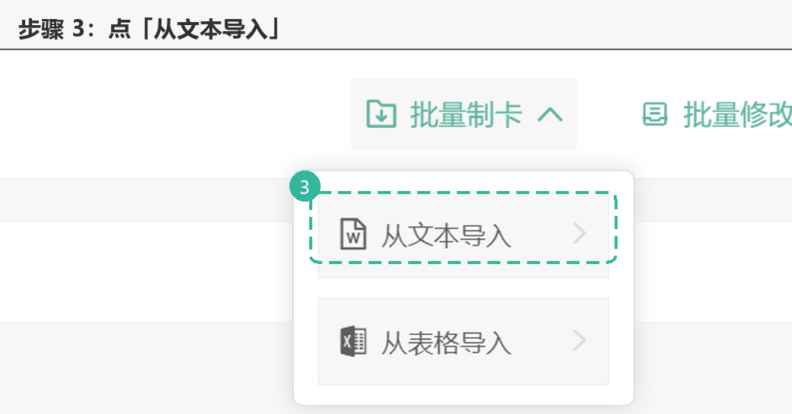
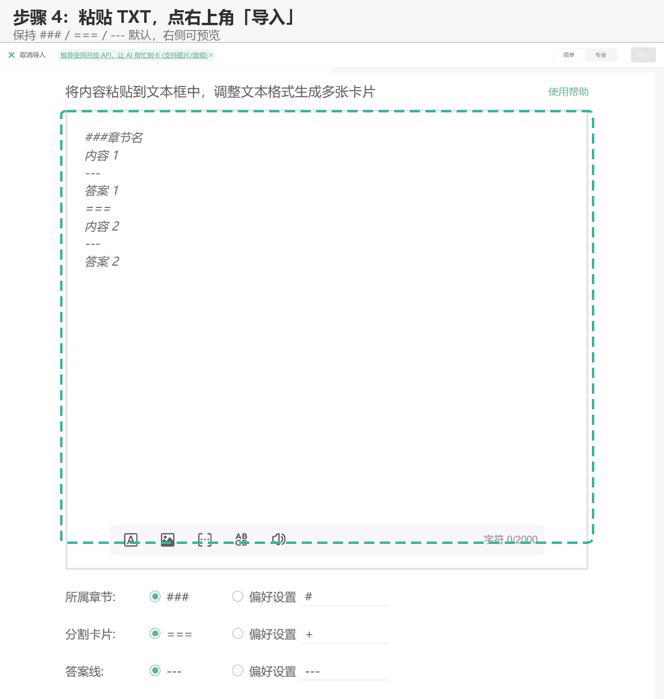

# 把 TXT 导入墨墨记忆卡（电脑版）

适用：Markji 电脑版 / 网页版制卡桌面。手机端入口不同，以当前界面为准。

## 四步操作

1. 打开电脑版 Markji，进入「制卡桌面」。
2. 点进你要导入 TXT 的牌组。
3. 点右上角「批量制卡」→「从文本导入」。
4. 把 TXT 内容粘贴到文本框，点右上角「导入」。

完整流程动图（3 帧）：[assets/import-flow-36b59d.gif](assets/import-flow-36b59d.gif)

动图版：[assets/import-menu-36b59d.gif](assets/import-menu-36b59d.gif)

## 导入窗口怎么填

- 有「简单 / 专业」切换时选「专业」，本技能的 `###` / `===` / `---` 语法按专业模式解析。
- 底部保持默认：所属章节 `###`、分割卡片 `===`、答案线 `---`（绿色选中项），不要改成「偏好设置」里的其它符号。
- 先看右侧「卡片预览」，确认张数与分卡正确再点「导入」。
- 单张卡片正文上限为 5000 字符；整个牌组的 TXT 导入没有总量限制，可以一次导入；超过 5000 字符的单卡需拆成多张卡。
- 带图片 / 音频的卡片，界面会推荐开放 API；纯文本仍可走这条 TXT 路径。

## 导入前检查

- 文件保存为 UTF-8；`###` 章节、`===` 分卡、`---` 答案线都必须各独占一行。
- 先跑 `python scripts/lint_txt.py <文件>`，确认章节名、卡片数和顺序对得上。
- 导入后核对章节名、卡片数量和顺序，不要只看“导入成功”提示。

## 说明

- 截图来自 Markji 网页版，只用于指示按钮位置；你的客户端界面可能略有差异。
- 第 4 步的弹窗样式会随版本变化；以你当前客户端为准。
- 本技能只生成、校验 TXT，不代用户操作客户端导入，也不上传文件。
